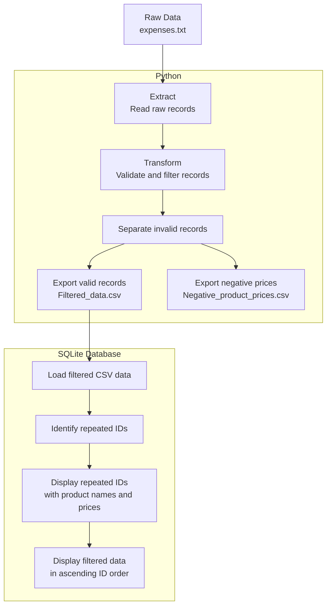

Summary:-
This is a ETL (Extract Transform Load) based project.
What it does?
(1)Extract:- Python reads the raw expenses.txt file and extracts its records.
(2)Transform:-Python validates the records, separates invalid data, and creates the filtered dataset.
(3)Load:-It will be saved in the database

##Diagram

So in diagram it will look like this :
Extract--->Transform--->Load

What does python do?
(1) Report Missing prices,product name and negative prices as well as filtered data
(2) Their are a total of five lists in python each corresponding to Missing prices and so on
(3) It also reads the file (Right now its hardcoded to expenses.txt) then all the data that is valid will be wrote
    inside of the Filtered_data.csv
(4) Their is another file that will report Negative File

What does Sql Do?
(1) It will show the filtered_data in structured format
(2) It also indentifies the repeated ID's and show their product name and prices with ID
(3)It also shows Filtered Data in Ascending Order

Limitation:-
(1) The project does not currently include Interactive Graphs
(2) The source file is currently Hardcoded so the pipeline is designed for this particular dataset.

NOTE:-SQLite does not remove or delete the Duplicate ID's instead it report Duplicate ID's along with their product name and price
